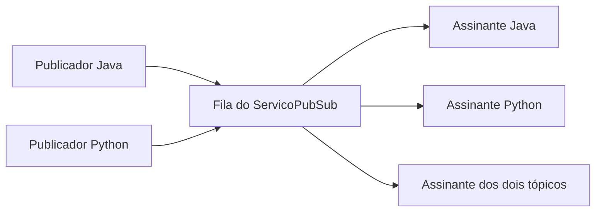

# Pub/Sub em Java

**Publicadores enviam mensagens por tópico; cada assinante recebe o conteúdo dos assuntos que acompanha.**

Demonstração do padrão *Publish–Subscribe* usando apenas classes Java e estruturas de dados em memória. O projeto separa publicação, assinatura e distribuição de mensagens, com uma aplicação de console que utiliza os tópicos `Java` e `Python`.

## Como funciona



O serviço mantém uma fila central de mensagens e um mapa de tópicos para conjuntos de assinantes. Publicar adiciona à fila; `distribuirMensagens()` consome essa fila e entrega cada mensagem aos assinantes registrados no tópico correspondente.

| Componente | Responsabilidade |
| --- | --- |
| `Mensagem` | Tópico e conteúdo do evento. |
| `Publicador` / `PublicadorImpl` | Publicar mensagens no serviço. |
| `Assinante` / `AssinanteImpl` | Gerenciar assinatura e mensagens recebidas. |
| `ServicoPubSub` | Registrar assinantes, manter a fila e distribuir eventos. |
| `AplicacaoPrincipal` | Montar e executar o cenário de demonstração. |

## Executar

Use um JDK com `javac` e `java` no PATH. Os comandos abaixo utilizam Bash e compilam o código-fonte atual, sem depender das classes antigas já presentes em `PubSubApp/bin`.

```bash
git clone https://github.com/dlr-1337/PubSub.git
cd PubSub
mkdir -p out
javac -encoding UTF-8 -d out $(find PubSubApp/src -name '*.java')
java -cp out pubsub.AplicacaoPrincipal
```

Também é possível abrir `PubSubApp/src` em uma IDE Java e executar `pubsub.AplicacaoPrincipal`.

## Cenário demonstrado

A aplicação publica inicialmente **três mensagens de Java e duas de Python**. Depois registra três assinantes e distribui a fila:

| Assinante | Conteúdo recebido na primeira distribuição |
| --- | --- |
| Apenas Java | As três mensagens de Java. |
| Apenas Python | As duas mensagens de Python. |
| Ambos os tópicos | As cinco mensagens. |

Em seguida, o exemplo publica mais duas mensagens de Java e usa a busca por tópico para entregá-las ao assinante Java. O console exibe os grupos de mensagens antes e depois dessa operação.

## Mapa do código

```text
PubSubApp/src/pubsub/
├── AplicacaoPrincipal.java
├── Mensagem.java
├── publisher/
├── service/
└── subscriber/
```

Comece por [`AplicacaoPrincipal.java`](PubSubApp/src/pubsub/AplicacaoPrincipal.java) e depois acompanhe o processamento em [`ServicoPubSub.java`](PubSubApp/src/pubsub/service/ServicoPubSub.java).

## Limitações importantes

Este exemplo roda em **um único processo**, sem broker externo, comunicação de rede ou persistência. A fila é consumida durante a distribuição; mensagens sem assinantes naquele momento não ficam armazenadas para entrega futura.

Na implementação atual, `entregarMensagensPorTopico` também remove os itens da fila central enquanto procura o tópico desejado. Portanto, não deve ser interpretado como uma consulta não destrutiva ou como consumo independente para cada assinante. Esse comportamento é relevante ao adaptar o exemplo para cenários maiores.

As coleções utilizadas não implementam, por si só, um mecanismo de entrega concorrente, confirmação, repetição ou garantia de durabilidade. O propósito do repositório é estudar o padrão e suas responsabilidades.

## Material de referência

Preservado do README original: [vídeo sobre a implementação Pub/Sub](https://www.youtube.com/watch?v=JAyU57uUMyg).
